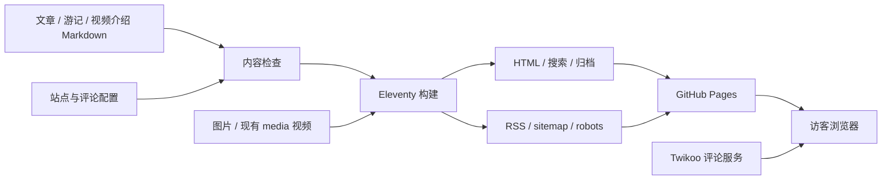

# 网站架构与维护说明

更新日期：2026-10-27。

文字内容现已迁入私有仓库 sakarijoy/blog-content，构建时读取。src 下的 Markdown 只作被 Git 忽略的临时输入；写作请在独立内容库进行。详见 [私有内容配置](private-content.md)。

当前网站继续采用 Eleventy + Markdown + GitHub Pages。文章、游记、视频介绍由文件维护；评论由独立的 Twikoo 服务保存。这个体量下，内容直接生成静态页面，写作、版本记录与部署路径都比较清楚。

## 已补齐的基础能力

| 能力 | 当前实现 | 写作时是否需要额外维护 |
| --- | --- | --- |
| 全站查找 | /search.html，按标题、摘要、作者、分类、地点搜索并按内容类型筛选 | 不需要，自动读取已发表记录 |
| 年份归档 | /archive.html，统一整理文章、旅行和视频 | 不需要，按 date 自动分组 |
| 连续阅读 | 详情页的上一篇、下一篇，限定同一栏目 | 不需要，自动按日期排列 |
| RSS 订阅 | /feed.xml，最近 30 条已发表记录的标题、摘要与原文地址 | 不需要，构建时生成 |
| 搜索引擎发现 | /sitemap.xml、/robots.txt 和正式网址 canonical | 只在更换域名时修改 site.url |
| 分享信息 | Open Graph 标题、简介、封面及链接，RSS 自动发现 | 有封面时使用封面，没有则使用站点图片 |
| 内容检查 | tools/content.mjs，在构建前检查 draft 类型、标题、摘要、日期、坐标和资源元数据 | 出错时按终端提示修改对应 MD |
| 发布检查 | npm run check：构建、资源/锚点、站点地图/RSS/分享信息和测试 | 发布前运行 |
| PR 检查 | .github/workflows/checks.yml，合并前运行同一套检查 | 推送 PR 后自动运行 |

## 数据如何进入网页

所有全站索引和阅读导航都来自同一份已发表内容集合。draft: true 的草稿不生成公开页，不进入搜索、归档、RSS、地图和阅读导航。draft: "true" 这类字符串会让构建失败，避免误当成已发表内容。

src/search.njk 的 noindex 用于避免搜索结果页成为重复索引；404 页同样不进入 sitemap。首页的 /index.html 规范化为正式域名的根地址。sitemap 未编造更新时间；需要精确 lastmod 时可在后续单独设计更新时间字段。

## 日常写作仍然保持简单

- 文章：复制 content-templates/article.md 到私有内容库 posts/。
- 旅行：复制 content-templates/travel.md 到私有内容库 travel/。
- 视频：复制 content-templates/video.md 到私有内容库 videos/，填写现有视频文件地址。
- 写好后把 draft 改为 false。搜索、归档、RSS 和导航都会自动更新。
- cover 一旦填写，就同时填写 coverAlt、coverWidth 和 coverHeight。没有封面时不必添加这些字段。
- 旅行地点可以暂不填写坐标；要显示点位时，成对填写数字纬度、经度。countryCode 使用两个大写字母。
- 修改文章文件名之前先按 docs/comments-setup.md 设置 commentId，以保留原留言归属。

站点正式网址集中保存在 src/_data/site.json 的 url。目前为 https://sakarijoy.github.io，更换域名时修改这一处，然后重新构建与发布。

## 发布与回退

1. 保存 MD，运行 npm run check。
2. 本地预览确认页面、视频、地图和留言区。
3. 文章提交到私有内容库；源码和公开媒体提交到网站仓库。文章更新后到网站 Actions 手动发布，或等待定时构建。
4. GitHub Actions 构建成功后才执行 Pages 部署；PR 仅检查，不部署。
5. 如需回退，使用 git revert 创建反向提交并推送，保留历史，不强制重写 main。

当前本地的已发布视频《轨道》仍保存在 media/。NAS 接入按用户要求保持暂停，没有迁移、删除或重写已有视频地址。此架构改动也未创建登录后台、数据库、云端存储或自动备份服务。

## 后续按需求再做

| 项目 | 需要解决什么 |
| --- | --- |
| NAS / 独立视频存储 | 视频直链、访客可达性及浏览器播放验证；当前暂停 |
| 双人在线编辑后台 | 两位作者的身份、内容写入权限和文件上传；当前仍采用 MD |
| 评论备份 | 从 Twikoo 管理端导出，具体步骤见评论配置说明；本次未执行远程操作 |
| 内容规模进一步增长 | 再评估列表分页和独立搜索索引；当前记录数量较少，不引入额外服务 |

## 参考标准

- sitemap：https://developers.google.com/search/docs/crawling-indexing/sitemaps/build-sitemap
- RSS 2.0：https://www.rssboard.org/rss-specification
- Open Graph：https://ogp.me/
