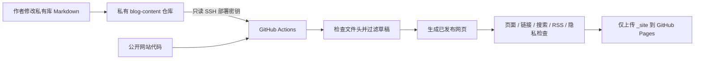

# 私有文章内容库

实施日期：2026-10-27。网站代码留在公开仓库，文章、游记、视频介绍保存到私有仓库 `sakarijoy/blog-content`。本地默认目录为网站旁边的 `sakarijoy-blog-content`。

## 构建链路

网站代码中的 `content-source.json` 保存仓库引用、分支与本地目录，没有文章正文或访问凭据。构建不会把 Markdown 推回网站代码库。现有各篇文件名保持不变，所以网址与默认评论路径不变。

## 作者日常使用

在私有库复制 `content-templates` 中的模板到 `posts/`、`travel/` 或 `videos/`，修改后提交到私有库。也可登录 GitHub，在私有仓库打开对应 MD，点编辑按钮修改并提交。第二位作者获邀请并接受后使用自己的 GitHub 账号操作，不共享密码。

发布时 `draft: false`，下架时 `draft: true`。两种状态必须明确填写且不加引号。新文件需要有效日期、标题与摘要；封面、坐标继续使用现有字段。每个栏目直接放 MD，暂不支持嵌套文件夹；空栏目保留 `.gitkeep`。内容不得设置 `layout`、`permalink`、`tags` 等模板字段。

立即上线：打开网站仓库的 **Actions → Build and deploy static blog → Run workflow**。也可以等待每半小时的定时构建；GitHub 调度可能延迟，长期无活动时可能停用。提交到文章仓库并不等于网站已部署，以上线工作流成功为准。

本地写作前，在文章库执行 `git pull --ff-only`；在网站库执行 `npm ci`、`npm run dev`。保存后自动完整重建并清理旧页面，刷新浏览器查看。不要修改网站 `src` 下的 MD 临时副本。

## 访问凭据

文章库的 **Settings → Deploy keys** 配置一个专用密钥，`Allow write access` 必须关闭。其私钥仅存于网站库 **Settings → Secrets and variables → Actions → Secrets → CONTENT_DEPLOY_KEY**。

网站运行器用该密钥读取 `.private-content/`，`persist-credentials: false`，不把密钥保留给后续构建步骤。构建成功后删除私有检出、清单及临时 MD，再上传 `_site`。密钥不能读取其他私有库，也不能写回文章库。

若将来轮换密钥：生成新的 Ed25519 密钥对 → 将公钥添加到文章库且保持只读 → 在网站库更新 `CONTENT_DEPLOY_KEY` 私钥 → 手动运行一次发布验证 → 删除旧公钥与临时私钥。不要在聊天、代码、日志或网页中填写私钥。

## 草稿与失败处理

- 在生成器启动前过滤草稿，草稿正文不进入 Eleventy 输入，不生成详情、地图、搜索、归档、RSS 或 sitemap。
- YAML 无效、缺少明确 draft、坐标等信息无效时停止构建；错误提示不打印文件正文。
- 删除或下架的文章在完整构建时从临时输入及旧输出中清理。
- 上传前检查文章页必须与已发布清单完全一致，并禁止 Markdown、YAML、Git 元数据、密钥和私有清单进入发布目录。
- 内容库不可用或 Secret 缺失会导致发布失败，线上继续保留上次成功部署。
- 公开代码的 PR 检查始终使用虚构样本，不向 PR 暴露私有内容或 Secret。
- 图片与现有视频仍位于公开网站目录，此次只迁移文字内容。私有仓库中不要新增待自动发布的媒体，当前构建不会复制它们。
- 已经发布的正文可被访客阅读；此前公开提交中已有的 MD 历史没有自动消失，本次不强制重写 Git 历史。

## 后台边界

此次完成内容存储分离与网站发布链路。当前在线写作入口是私有仓库的 GitHub 文件编辑器，尚未配置独立 `/admin/`、OAuth 登录或第二位管理员。后续后台应写入此私有仓库，继续使用同一套发布与草稿规则。Twikoo 评论服务与 NAS 暂停状态保持不变。

## 官方说明

- 私有仓库检出：https://github.com/actions/checkout#checkout-multiple-repos-private
- 只读部署密钥：https://docs.github.com/en/authentication/connecting-to-github-with-ssh/managing-deploy-keys
- Actions Secrets：https://docs.github.com/en/actions/concepts/security/secrets
